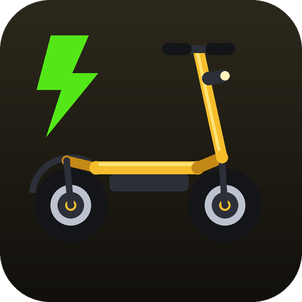
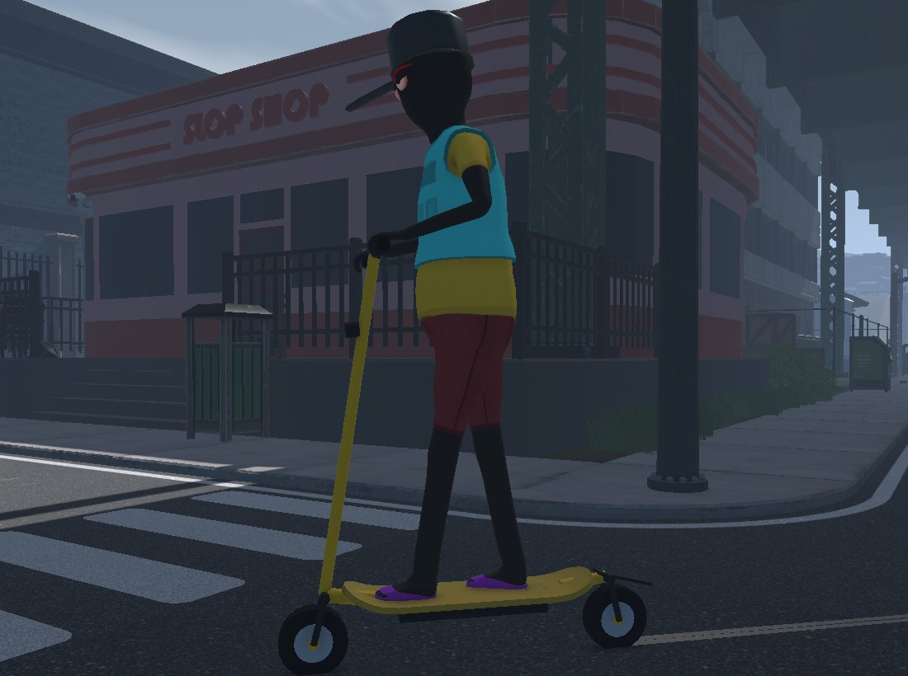
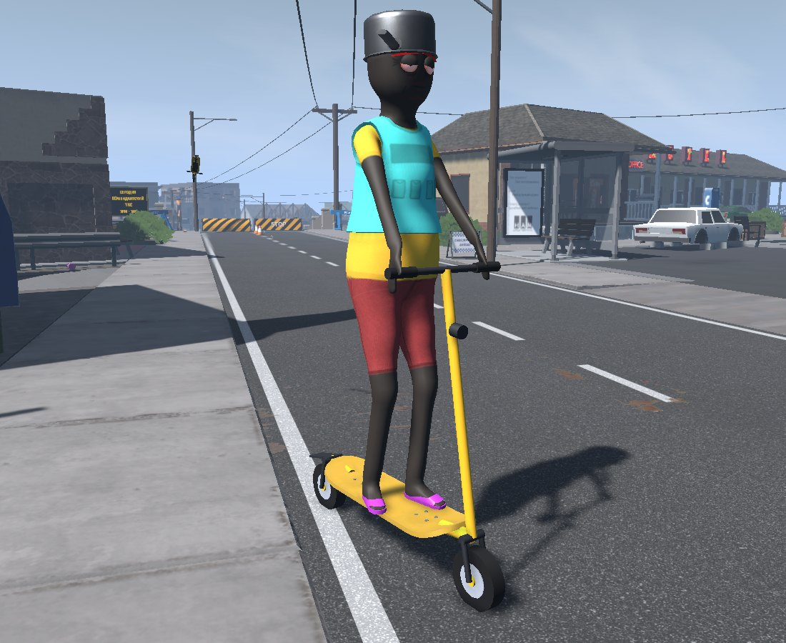
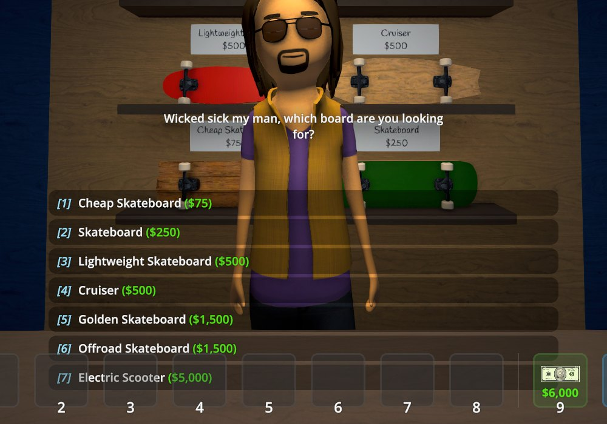
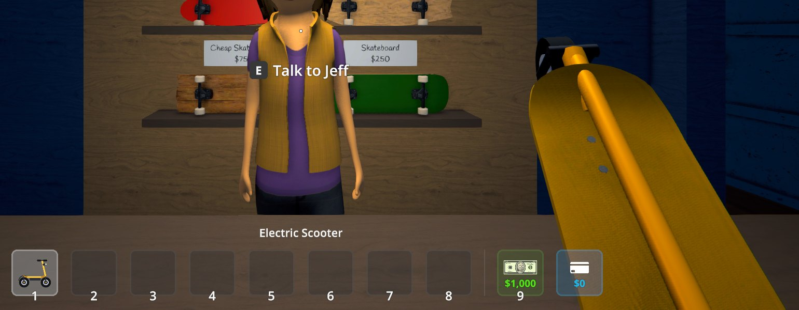

# Electric Scooter



A new ride for **Schedule I**: an electric scooter sold at the skate shop. It handles like the
Golden Skateboard, but it rolls over curbs instead of stopping at every one of them, costs no
stamina and is 30% faster.

<p>
  
  
</p>
<p>
  
  
</p>

## Features

- **Sold by Jeff at the skate shop** for $5,000, next to the skateboards. It is a normal item:
  it sits in your hotbar, can be stored, and is kept in your save.
- **Rides like the Golden Skateboard**: hold the left mouse button to get on, press it to get off;
  the same steering, braking and jumping.
- **Does not stop at curbs.** Skateboards ride so low that every curb of Hyland Point (9 cm) stops
  them. The scooter rides on big wheels and clears steps up to 20 cm.
- **No stamina.** It is electric: the motor pushes while you just stand, so you never have to
  stop and catch your breath.
- **30% faster** than the Golden Skateboard — top speed and acceleration alike.
- Its own look: big wheels, steering column with a handlebar, headlight and a battery under the
  deck. In your hands it is carried folded.
- **Rides like a scooter, not a skateboard**: your character stands upright facing forward, one
  foot ahead of the other, palms on the grips and fingers round them, instead of standing sideways
  and kicking the road.
- **Multiplayer**: other players who have the mod see your scooter and how you ride it.
- Translated into all [Polyglot](../Polyglot) languages.

## Installation

**With a mod manager** (r2modman, Thunderstore App): install [ElectricScooter](https://thunderstore.io/c/schedule-i/p/BbIJABNPOBATEJb/ElectricScooter/) for the default Steam branch or [ElectricScooter_Mono](https://thunderstore.io/c/schedule-i/p/BbIJABNPOBATEJb/ElectricScooter_Mono/) for the `alternate` branch. Also on [Nexus Mods](https://www.nexusmods.com/schedule1/mods/2754).

**Manually:**

1. Install [MelonLoader](https://github.com/LavaGang/MelonLoader/releases) 0.7.3 (0.7.1 is not supported).
2. Download `ElectricScooter-<version>-IL2CPP.zip` (default Steam branch) or `ElectricScooter-<version>-Mono.zip`
   (`alternate` branch) from [Releases](https://github.com/BbIJABNPOBATEJb/ScheduleI-Mods/releases).
3. Extract it into the game folder so that `Mods/ElectricScooter_Il2Cpp.dll` (or `_Mono.dll`) is in place.

Only install the build matching your game branch.

## Configuration

`UserData/MelonPreferences.cfg`:

```ini
[ElectricScooter]
Price = 5000            # price at the skate shop, $
SpeedPercent = 130      # speed compared to the Golden Skateboard, % (50-300)
StepHeightCm = 20       # how high a curb it rolls over, cm (10-40); the wheels grow with it
InfiniteStamina = true  # riding does not use stamina
```

Edit the file while the game is closed. If you change the values with an in-game preferences
editor, they apply the next time you get on the scooter (the price: the next time you load a save).

## Multiplayer

The rider's own game simulates the ride, so the scooter works for whoever has the mod. Since 1.2.0
it also tells the other players' games that the board in your hands or under your feet is a
scooter, and those with the mod build it there and pose you on it. Players without the mod see a
Golden Skateboard floating a little higher than usual. Everyone who may handle the item (shared
storage, handing it over) needs the mod.

The multiplayer part is new and has not been tried in a real lobby yet; please report how it goes.

## Uninstalling

Sell or drop the scooter first. Without the mod the game does not know the item, and it disappears
from saves that contain it.

## Changelog

See [CHANGELOG.md](CHANGELOG.md).

## Credits

- RebornReaper: the riding pose (stance, palms and fingers on the grips, raised handlebar) and the
  multiplayer visuals come from his ElectricScooter add-on, used with his permission; he also found
  the shop stutter fixed in 1.1.0.
- Developed with AI assistance (Claude by Anthropic) and tested in game on both branches with
  automated in-game tests.

## License

MIT.
